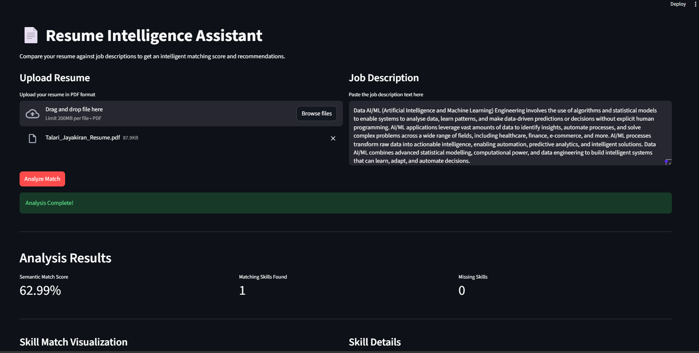

# Resume Intelligence Assistant

A professional NLP-powered application that compares a resume against a job description and provides an intelligent matching score, skill gap analysis, and personalized recommendations.

The project uses Sentence Transformers to understand semantic meaning rather than relying only on keyword matching, helping users evaluate how well their resume aligns with a target role.

---

## Features

* Upload Resume in PDF format
* Paste Job Description text
* Semantic Similarity Matching using Sentence Transformers
* Resume–Job Description Match Score
* Automatic Skill Extraction
* Matching Skills Detection
* Missing Skills Identification
* Interactive Streamlit Dashboard
* Personalized Improvement Recommendations
* Visual Skill Match Analysis using Plotly

---

## Technologies Used

* Python
* Streamlit
* Sentence Transformers
* Scikit-Learn
* spaCy
* PyMuPDF
* Plotly
* NumPy
* Pandas

---

## NLP Concepts Used

### Semantic Embeddings

The project converts resumes and job descriptions into dense vector embeddings using a pre-trained Sentence Transformer model. These embeddings capture the meaning of text rather than relying on exact keyword matches.

### Sentence Transformers

The application uses the `all-MiniLM-L6-v2` model from Sentence Transformers to generate semantic representations of text.

### Cosine Similarity

Cosine Similarity is used to measure how closely a resume aligns with a job description. The resulting similarity score is converted into a percentage match score.

### Skill Extraction

A custom skill extraction module identifies technical skills from resumes and job descriptions, allowing the system to highlight matching and missing skills.

---

## Project Structure

```text
resume-intelligence-assistant/
│
├── app/
│   └── main.py
│
├── models/
│   └── nlp_engine.py
│
├── utils/
│   ├── text_processing.py
│   └── skill_extractor.py
│
├── assets/
│   └── dashboard.png
│
├── requirements.txt
├── README.md
└── .gitignore
```

---

## How It Works

1. Upload a resume in PDF format.
2. Paste the target job description.
3. The system extracts text from the resume.
4. Both texts are cleaned and processed.
5. Sentence Transformer embeddings are generated.
6. Cosine Similarity is calculated to produce a semantic match score.
7. Skills are extracted from both documents.
8. Matching and missing skills are identified.
9. Results are displayed through an interactive dashboard.

---

## Screenshots

### Dashboard

Add your dashboard screenshot here:

```markdown

```

### Skill Analysis

Add your skill matching visualization screenshot here:

```markdown

```

---

## Installation

### Clone the Repository

```bash
git clone <repository-url>
cd resume-intelligence-assistant
```

### Create Virtual Environment

```bash
python -m venv venv
```

Activate the environment:

Windows:

```bash
venv\Scripts\activate
```

Linux / Mac:

```bash
source venv/bin/activate
```

### Install Dependencies

```bash
pip install -r requirements.txt
```

### Run the Application

```bash
streamlit run app/main.py
```

---

## Usage

1. Upload your resume PDF.
2. Paste the job description.
3. Click **Analyze Match**.
4. Review:

   * Semantic Match Score
   * Matching Skills
   * Missing Skills
   * Improvement Recommendations

---

## Future Improvements

* ATS Resume Scoring
* PDF Report Export
* Resume Section Analysis
* LLM-Based Resume Suggestions
* Resume Ranking for Multiple Job Descriptions
* Support for DOCX Files
* Personalized Learning Recommendations

---

## Author

Built by

**Thurpu Maruthi Ganesh**

Artificial Intelligence & Machine Learning Student

GitHub: https://github.com/MaruthiganeshT
